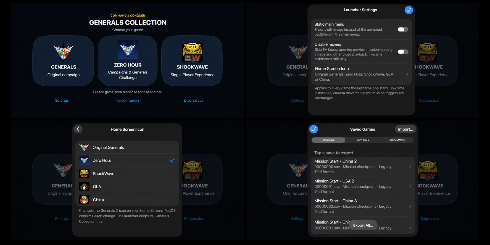

# Generals X — iOS Collection



A native iPhone/iPad fork of [ammaarreshi/Generals-Mac-iOS-iPad](https://github.com/ammaarreshi/Generals-Mac-iOS-iPad), adding original Generals support, an optional-game launcher, isolated mod profiles, PC save transfer and audio/video/timing fixes.

**Bring your own installed game folders. No retail game archives, movies, mod packages, saves, or signing credentials are distributed here.** You choose what to include: Generals, Zero Hour, ShockWave + Single Player Experience, or a documented custom Zero Hour mod profile. Building does not require AI.

## Build on a Mac

One-time requirements:

- Full Xcode, opened once to finish setup, with its iOS SDK and command-line tools selected.
- Homebrew tools: `brew install cmake ninja meson pkgconf python xcodegen autoconf automake libtool`.
- The LunarG **macOS Vulkan SDK**, including the iOS MoltenVK libraries. The tested SDK is 1.4.363.0. Set `VULKAN_SDK` to its `macOS` directory, or let the helper find it under `~/VulkanSDK`.
- Your own installed game files. For ShockWave + SPE, supply a complete Zero Hour installation with ShockWave 1.201 and SPE 2.1.3 applied; a Windows installer EXE alone is not an installation folder.

```sh
git clone https://github.com/PickledCakes/Generals-X-iOS.git
cd Generals-X-iOS
./build.command
```

The interactive helper asks which games to include, where their full installation folders are, and optionally your own Apple Team ID and bundle identifier. It writes an ignored `build.local.json`. It fetches the pinned vcpkg/DXVK dependencies, stages fonts and MoltenVK, prepares only the selected game profiles, derives icons locally and builds the app/IPA.

Leave the Team ID blank for an **unsigned/ad-hoc IPA** that you sign using your own sideloading tool. For Xcode signing, first sign into your Apple Account in Xcode Settings → Accounts and enter your Team ID and a unique bundle identifier when prompted.

```sh
./build.command --install    # signed build; discovers your connected device
```

Outputs: `build/ios-package-collection/GeneralsCollection.app` and `GeneralsX.ipa`. The Home Screen name is **Generals X**; the launcher title is **Generals Collection**.

See the [full build guide](docs/HOWTO/IOS-COLLECTION-BUILD.md) for noninteractive configuration, signing, supported folder layouts, troubleshooting and test limits.

## File checks are advisory

Before compiling, the helper compares known, stable content assets with SHA-256 reference manifests. It lists every missing or mismatched reference file **as a warning and continues**. A different language, retailer, patch or mod can legitimately differ from the reference.

Account/DRM files, executables, DLLs, Steam manifests, `game.dat`, `gensec*.big`, launcher settings, saves and caches are **not checksummed**. Files absent from the reference list are unverified. A checksum warning does not by itself fail a build; a missing installation folder, missing build dependency or unusable required mod archive can still prevent staging/compilation.

## Features

- Selectable game profiles: bundle only what you choose. ShockWave is optional.
- Separate assets, saves, settings, registry data and logs for each profile.
- Static main-menu and disable-movies switches; in-engine cinematics remain enabled.
- Saved-game import/export through Files and the share sheet, with non-overwriting imports.
- Five Home Screen icon choices, derived from supplied artwork where available; neutral generated tiles otherwise.
- One game per app session. Exit Game closes the app; reopen it to choose another.
- Diagnostics and per-profile settings reset.

For another BIG-based Zero Hour mod, see [adding a content profile](docs/HOWTO/IOS-MOD-PROFILES.md). New profiles do not require changing the launcher UI, save-transfer code or engine-selection switch.

## Contributors and AI development disclosure

- **[PickledCakes](https://github.com/PickledCakes)** — fork maintainer, project direction, development, testing and integration.
- **OpenAI Codex** — AI coding assistant used to develop and refine this fork's iOS launcher, build workflow and compatibility changes.

**AI-assisted development disclaimer:** This fork was built with the assistance of OpenAI Codex. Codex was used to generate and modify code under the maintainer's direction. The maintainer is responsible for reviewing, testing and maintaining the resulting changes. This disclosure applies to the work on this fork, not to the original upstream projects or third-party components.

## Status and credits

This is an experimental device-tested port, not an official EA release or a promise that every mission/mod/device works. The current development version was exercised on an iPad mini (A17 Pro), including original Generals/Zero Hour campaigns, PC snapshot loads, and initial ShockWave + SPE campaign tests. A complete clean-machine engine build of this release workflow is still a separate validation target; the original engine build and the new staging/launcher packaging are tested independently. See [validation details](docs/HOWTO/IOS-COLLECTION-BUILD.md#validation).

The port rests on **EA's source release**, **TheSuperHackers' engine work**, **Fighter19's Unix port**, **fbraz3/GeneralsX**, and **Ammar Reshi's original iOS/iPadOS port**. This fork adds the collection launcher and compatibility fixes developed and playtested by PickledCakes with Codex. The [original README](docs/port/UPSTREAM_README.md) and [porting history](docs/port/PORTING_PLAYBOOK.md) preserve upstream attribution.

ShockWave is by SWR Productions; Single Player Experience is by WARthog. Their content is supplied by the user and retains its own authorship/terms. Screenshot artwork illustrates a local installation and is not licensed as engine source.

Engine source uses [GPLv3 with EA's additional terms](LICENSE.md). Those terms include trademark restrictions; no EA affiliation or trademark rights are claimed. Third-party libraries and fonts retain their own licenses. See [third-party notices](docs/HOWTO/IOS-THIRD-PARTY.md).
